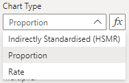
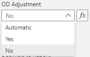
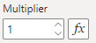
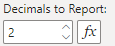
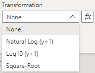
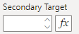

With the data settings, the key settings used to display the Funnel chart can be modified.

## Chart Type
The Funnel chart is set to proportion (PR) charts by default. There are other options available which use an assumed probability model to compute the 2 and 3-sigma limits. These three options are:

| Display Name | Value |
| -- | -- |
| Indirectly Standardised (HSMR) | SR |
| Proportion | PR |
| Rate | RC |

{fig-alt="Chart Type"}

When using conditional formatting, set your values to one of SR, PR or RC to select the chart type. The default setting is Proportion (PR).

See the documentation on Chart Types for further details on each type.

## OD Adjustment
The Overdispersion (OD) Adjustment dropdown allows for overdispersion to be toggled on or off for the funnel plot, or set to automatic which will only apply the overdispersion factor if it is detected. The three options are:

| Display Name | Value |
| -- | -- |
| Automatic | auto |
| Yes | yes |
| No | no |

{fig-alt="OD Adjustment"}

When using conditional formatting, set your values to one of auto, yes or no. The default setting is No.

## Multiplier
The multiplier affects the scale of the final value that is displayed in the SPC chart, with the default set to 1. This setting applies uniformly across all chart types, except for the p-chart which defaults to a multiplier of 100.

{fig-alt="Multiplier"}

## Decimals to Report
Sets the number of decimal places reported in the y-axis and tooltip. The number of decimal places in the y-axis can be overwritten by the Y-Axis Tick Settings.

{fig-alt="Decimals To Report"}

## Transformation
This settings affects the transformation that is applied to the y-axis, to be applied when the distribution of the points are not conforming to the underlying probability distribution. The four options are:

| Display Name | Value |
| -- | -- |
| None | none |
| Natural Log (y+1) | ln |
| Log10 (y+1) | log10 |
| Square-Root | sqrt |

{fig-alt="Transformation"}

When using conditional formatting, set your values to an item in the Value column. The default setting is None.

## Secondary Target
By default, the Funnel chart depicts a statistical centerline as set by the chart type. This allows for a comparison of where the groups compare to the overall centerline. However, there are applications where a target value may be appropriate to include as well. This can be set using this option.

{fig-alt="Secondary Target Value"}

## All Settings


