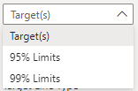
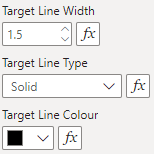

With the line settings, users can modify the width, type and colour of the lines in the SPC chart. Each line type can be modified by selecting the different line type:

{fig-alt="Line Options"}

{fig-alt="Line Settings"}

## All Settings


