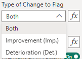
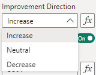
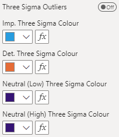

Funnel patterns can be displayed and formatted in this section.

## Type of Change to Flag
This setting determines whether improvement and deterioration are both flagged, or only one of these directions are flagged. These apply across all the enabled patterns. The various options can be selected in the drop down menu:

{fig-alt="Type of Change to Flag"}

- **Both** - Both improvement and deterioration patterns are highlighted (default)
- **Improvement (Imp.)** - Only improvement patterns are highlighted
- **Deterioration (Det.)** - Only deterioration patterns are highlighted

To use these with the conditional formatting, the values must be set to only **both**, **improvement** and **deterioration** respectfully.

This setting should be used in conjunction with the **Improvement Direction** setting below. With a **Neutral** improvement direction there is no improvement or deterioration to choose between, so outliers on both sides are always highlighted.

## Improvement Direction
This setting determines which direction is deemed to be the improvement direction for the measure. That is, the measure is getting better in this direction. The various options can be selected in the drop down menu:

{fig-alt="Improvement Direction"}

- **Increase** - The measure increasing is a favourable outcome, and signals improvement in the measure (default).
- **Neutral** - There is no direction set, and the measure increasing or decreasing does not signal improvement or deterioration. This setting is used to detect any statistical variation.
- **Decrease** - The measure decreasing is a favourable outcome, and signals improvement in the measure.

To use these with the conditional formatting, the values must be set to only **increase**, **neutral** and **decrease** respectfully.

This setting should be used in conjunction with the **Type of Change to Flag** setting above.

## Pattern Options for Three and Two Sigma
This section covers the settings that are common across the three sigma and two sigma outliers. The below shows the example for three sigma outliers:

{fig-alt="Pattern Common Options"}

Each pattern's settings are listed under [All Settings](#all-settings). The default colours are consistent with the NHS theme.

## All Settings


