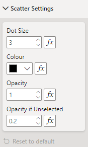

Contains the settings for formatting the points on the SPC chart.

{fig-alt="Padding"}

Apart from **Show Group Text**, each setting can also be configured using conditional formatting, allowing for different dot sizes, colours and opacities. Colour should be set using the hex colour code.

## All Settings


