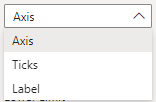

All settings related to formatting the x-axis are available in this section. These are grouped by the four categories, Axis, Ticks, Label and Gridlines.

{fig-alt="X Axis Settings Group"}

Please note that although the lower and upper limit truncate the Funnel chart, the centerline and limits are not recalculated and will be based on all the data available.

## All Settings


